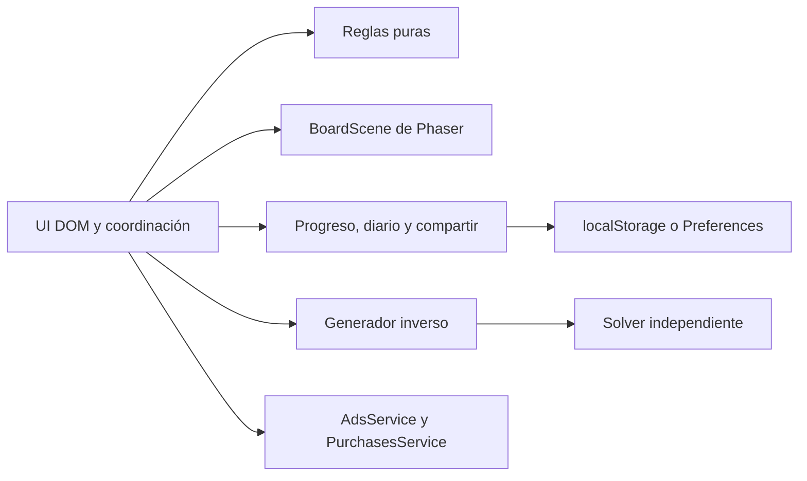

# Arquitectura y garantías

## Reglas y representación

El motor no importa Phaser, DOM, temporizadores ni almacenamiento. `attemptMove` devuelve un estado nuevo y el resultado de la acción. Un ID retirado, desconocido o perteneciente a una partida terminada no consume vidas. El validador rechaza dimensiones fuera de 1–10, IDs no admitidos, ocupaciones duplicadas y direcciones inexistentes.

Los botones DOM superpuestos al canvas aportan nombres de dirección y posición, teclado y objetivos táctiles correspondientes a las celdas. Phaser dibuja y anima. La forma geométrica identifica cada dirección independientemente de la paleta.

## Prueba de solubilidad

Sea `B(k)` el tablero tras insertar `a(k)`. La nueva flecha tiene trayectoria libre respecto a `B(k-1)`. Retirar `a(n)` de `B(n)` es válido y deja `B(n-1)`. El argumento se repite inductivamente: la secuencia inversa de inserción es una solución.

Cada nueva celda recibe una puntuación según las trayectorias existentes que atraviesa, ponderada por complejidad y variación determinista. Así se crean dependencias sin romper la garantía. Los objetivos de movimientos iniciales, profundidad y dependencia se buscan dentro de cuatro intentos. Si falta densidad, el fallback inserta capas del centro al borde. Cada flecha apunta hacia el exterior sobre el eje más alejado del centro: la distancia máxima al centro aumenta estrictamente a lo largo de su trayectoria. Los bloqueos siempre llevan a capas exteriores y no pueden formar ciclos. Esto permite densidad completa con cuatro direcciones.

El solver no llama `findBlocker`: calcula relaciones geométricas por pares y retira nodos sin bloqueos. Si quedan nodos, hay un ciclo. Retirar una flecha válida nunca añade bloqueos; por eso no se necesita backtracking. El grafo cuesta O(n²), con un máximo de 100 flechas.

`inverse-v1` identifica PRNG, orden de candidatos, puntuación y presupuesto de generación predeterminado. Si una actualización cambia tableros, deberá crear otra versión o conservar el generador anterior. Los enlaces de versiones desconocidas se rechazan.

## Sesiones y concurrencia

Cada sesión conserva ID, modo, semilla, parámetros, versión, tablero inicial, estado, tiempo y banderas `counted`/`recorded`. El estado se aplica antes de animar. La entrada se bloquea hasta finalizar la animación. Un contador de montaje impide que una escena antigua modifique la siguiente pantalla.

El resultado se registra antes de animar el último movimiento. Al cargar, se reconcilian sesiones terminales no registradas. Reiniciar crea otro intento con el mismo tablero; continuar conserva el ID y no duplica partidas.

El reloj usa `performance.now()`, excluye pausas y segundo plano y limita saltos de tick. La visibilidad del documento y App en Capacitor guardan y pausan. Android dispone de navegación atrás y minimización desde inicio.

## Guardados

Clave: `flecha-trampa:profile:v1`; copia anterior: sufijo `:backup`. La validación comprueba tipos, rangos, geometría, vidas, errores, movimientos, condición terminal, pertenencia al tablero inicial y solubilidad. Los primeros guardados de esquema 1 reciben campos diarios y compartidos mediante migración aditiva.

Se escribe primero la copia válida anterior y después el principal. Preferences serializa ese orden. Los fallos de permisos, cuota o plugin permiten continuar en memoria e informan al usuario. El almacenamiento no está cifrado ni concede derechos de pago.

Antes de escribir se comprueba que el principal no haya cambiado desde la última observación. El evento `storage` detecta otras pestañas. Una pestaña antigua deja de escribir y solicita cargar el progreso reciente, sin mezclar partidas.

## Fechas y enlaces

Las fechas y rachas usan UTC. Cada fecha completada suma una vez. Los mejores resultados priorizan menos errores y, a igualdad de errores, menor tiempo. La racha visible caduca tras un día sin completar. El reloj y los resultados locales no permiten rankings fiables sin backend.

`#reto=FT1.payload.checksum` contiene esquema, generador, semilla y parámetros en base64url con Unicode. El checksum detecta daños accidentales: no es una firma ni una protección contra trampas. El fragmento evita rutas dinámicas en hosting estático. Los valores mostrados en HTML se escapan.
