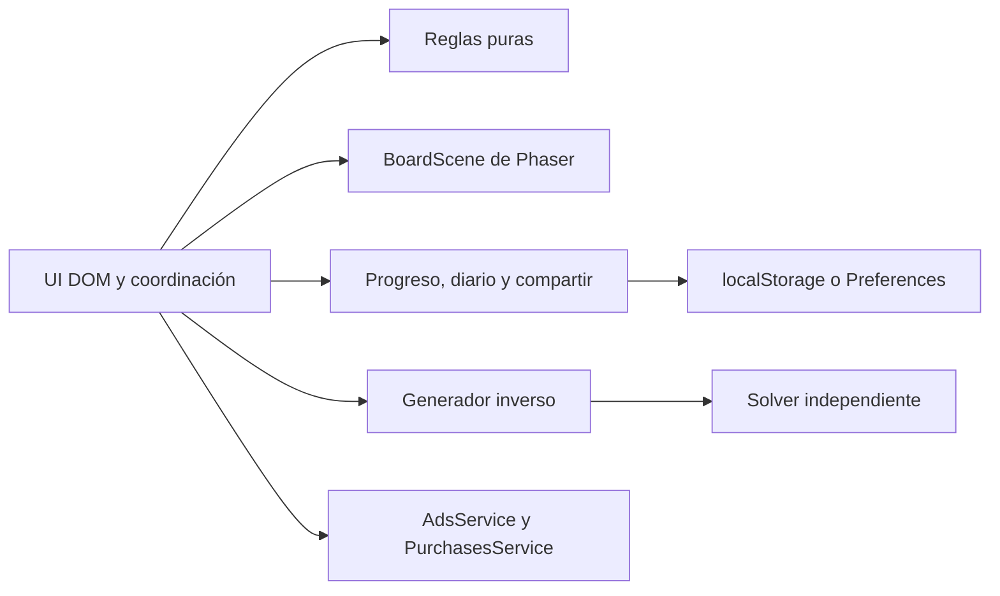

# Arquitectura y garantías

## Siluetas, lectura de rutas y dominio

`generator/shapes.ts` define cinco máscaras originales. El generador inverso solo inserta en celdas admitidas, la densidad usa el área de la máscara y el fallback conserva la prueba de potencial creciente. Las trayectorias siguen recorriendo el rectángulo completo, incluso a través de los huecos. Ausencia de `shape` conserva los tableros rectangulares anteriores; `classicConfigForLevel` añade las formas únicamente a nuevos intentos clásicos. El diario conserva su configuración. Enlaces y validador de guardados transportan y verifican el parámetro.

`BoardInput` reconoce la pulsación de 420 ms, rechaza desplazamientos, scroll, cancelación y pérdida de foco, e impide que el clic de compatibilidad ejecute otra acción. `RouteInspector` presenta el primer bloqueo calculado por las reglas puras. No muta el tablero ni consume pistas. El botón Rutas ofrece el mismo acceso por teclado. Las ondas de desbloqueo solo marcan movimientos recién válidos. Ni estos efectos ni la pulsación desplazan la geometría de los objetivos.

`core/mastery.ts` calcula estrellas a partir de victoria, errores y pistas consumidas. `ProgressStore.consumeHint(session)` persiste contador y consumo en una transacción. Cada resultado se registra una sola vez; los guardados antiguos sin contador no reciben la estrella por ausencia de pistas. `bestCombo` se conserva por intento y la nueva estadística `mastered` migra a cero. La presentación está en `ui/mastery.ts` y el tablero DOM en `ui/game-screen.ts`.

## Geometría y presentación cosmética

`config/arrow-designs.ts` y `arrow-expansion.ts` definen 32 siluetas, 16 familias de salida, caras y tintas originales en coordenadas normalizadas. SVG y Phaser consumen la misma geometría. `SkinMotionPreview` limita la vida de las animaciones del inspector; un identificador de generación impide que una finalización antigua borre una vista nueva. `home.ts` y las vistas previas de escenarios utilizan la pieza equipada.

`ChestOpening` presenta un premio que `ProgressStore.openChest()` ya sorteó y guardó. `chest-reel.ts` separa tarjetas decorativas, encuadre y frenado de la economía. Saltar, ocultar, redimensionar y navegar cancelan temporizadores y animaciones, sin repetir transacciones. Los clics y acordes se sintetizan y se detienen al salir. Los ambientes de los escenarios son CSS acotado; se pausan tras modales y compras y se omiten con movimiento reducido. Ver [diseño y garantías](COSMETICS.md).

## Reglas y representación

El motor no importa Phaser, DOM, temporizadores ni almacenamiento. `attemptMove` devuelve un estado nuevo y el resultado de la acción. Un ID retirado, desconocido o perteneciente a una partida terminada no consume vidas. El validador rechaza dimensiones fuera de 1–10, IDs no admitidos, ocupaciones duplicadas y direcciones inexistentes.

Los botones DOM superpuestos al canvas aportan nombres de dirección y posición, teclado y objetivos táctiles correspondientes a las celdas. Phaser dibuja y anima. La forma geométrica identifica cada dirección independientemente de la paleta.

## Prueba de solubilidad

Sea `B(k)` el tablero tras insertar `a(k)`. La nueva flecha tiene trayectoria libre respecto a `B(k-1)`. Retirar `a(n)` de `B(n)` es válido y deja `B(n-1)`. El argumento se repite inductivamente: la secuencia inversa de inserción es una solución.

Cada nueva celda recibe una puntuación según las trayectorias existentes que atraviesa, ponderada por complejidad y variación determinista. Así se crean dependencias sin romper la garantía. Los objetivos de movimientos iniciales, profundidad y dependencia se buscan dentro de cuatro intentos. Si falta densidad, el fallback inserta capas del centro al borde. Cada flecha apunta hacia el exterior sobre el eje más alejado del centro: la distancia máxima al centro aumenta estrictamente a lo largo de su trayectoria. Los bloqueos siempre llevan a capas exteriores y no pueden formar ciclos. Esto permite densidad completa con cuatro direcciones.

El solver no llama `findBlocker`: calcula relaciones geométricas por pares y retira nodos sin bloqueos. Si quedan nodos, hay un ciclo. Retirar una flecha válida nunca añade bloqueos; por eso no se necesita backtracking. El grafo cuesta O(n²), con un máximo de 100 flechas.

`inverse-v1` identifica el algoritmo anterior. La revisión opcional `config.tuning: chain-v2` usa presión de cadena y un análisis de las celdas que quedarían encerradas antes de insertar. Esto permite mayor densidad sin agotar las posiciones disponibles; mantiene cuatro intentos y el mismo fallback probado. FT3 transporta esta revisión, mientras FT1/FT2 mantienen sus tableros y formatos. Ver [métricas reproducibles](BALANCE.md). Si una actualización cambia tableros, deberá crear otra versión o conservar el generador anterior. Los enlaces de versiones desconocidas se rechazan.

## Sesiones y concurrencia

Cada sesión conserva ID, modo, semilla, parámetros, versión, tablero inicial, estado, tiempo y banderas `counted`/`recorded`. El estado se aplica de forma síncrona antes de animar. Los controles HTML se actualizan sin reconstruir las flechas restantes y aceptan otras jugadas mientras las animaciones se solapan. Solo la flecha bloqueada tiene un breve bloqueo local. `BoardInput` distingue taps de arrastres y evita el click duplicado. Un contador de montaje impide que una escena antigua modifique la siguiente pantalla.

`energy.ts` contiene regeneración y consumo puros. `economy.ts`, `config/pass.ts` y `config/collection.ts` definen el inventario, la temporada y las probabilidades de cofres. `ProgressStore` cobra cada intento una vez, mantiene el coste por intento bajo `energyPolicy: attempt-v2`, respeta el reembolso único de sesiones anteriores y registra XP y premios de forma idempotente. Los derechos de pago se consultan al adaptador de compras y no se infieren del guardado. `save-validation.ts` migra los perfiles anteriores sin borrar sus partidas. Ver [reglas y límites de economía](ECONOMY.md).

El resultado se registra antes de animar el último movimiento. Al cargar, se reconcilian sesiones terminales no registradas. Reiniciar crea otro intento con el mismo tablero; continuar conserva el ID y no duplica partidas.

El reloj usa `performance.now()`, excluye pausas y segundo plano y limita saltos de tick. La visibilidad del documento y App en Capacitor guardan y pausan. Android dispone de navegación atrás y minimización desde inicio.

## Guardados

Los escenarios se definen en `config/worlds.ts`; los dibujos originales son SVG en `ui/world-art.ts`. `ProgressStore` registra sellos por primeras victorias y conserva los fondos adquiridos. La compra cosmética gratuita no toca energía, skins o paletas. `save-validation.ts` añade inventario y fondo inicial a perfiles anteriores.

La distribución interna usa `PreviewAdsService` y `PreviewPurchasesService` con un puerto de presentación inyectado (`CommercePreviewPort`). El servicio es comprobable sin DOM; `CommercePreviewView` gestiona foco, segundo plano, temporizadores y cancelación. Los derechos de prueba están en una clave independiente y nunca sirven como recibos de tienda. El modo `disabled` vuelve a NoOp. Un proveedor comercial futuro deberá usar recibos y verificación reales; no debe aceptar el almacenamiento del simulador.

`ComboEffects` contiene solo efectos decorativos sin entrada. Se acotan partículas y oleadas y se cancelan animaciones al cambiar de pantalla. No se desplaza la cámara ni el tablero. `config/combos.ts` define los hitos y el medidor reutiliza el tiempo de la cadena pura. La reducción de movimiento se consulta tanto en DOM como en Phaser.

`BoardRenderer.setPaused()` duerme el TimeStep de Phaser detrás de un modal y al ocultar el documento; lo despierta al continuar. Así se evitan frames WebGL continuos detrás del desenfoque de pausa. El montaje respeta modales abiertos antes de que el canvas esté listo, el evento de visibilidad se aplica después del manejador propio de Phaser y la destrucción despierta el frame que procesa `pendingDestroy`. Los movimientos ya aplicados conservan sus animaciones pendientes y se completan al reanudar.

Clave: `flecha-trampa:profile:v1`; copia anterior: sufijo `:backup`. La validación comprueba tipos, rangos, geometría, vidas, errores, movimientos, condición terminal, pertenencia al tablero inicial y solubilidad. Los primeros guardados de esquema 1 reciben campos diarios y compartidos mediante migración aditiva.

Se escribe primero la copia válida anterior y después el principal. Preferences serializa ese orden. Los fallos de permisos, cuota o plugin permiten continuar en memoria e informan al usuario. El almacenamiento no está cifrado ni concede derechos de pago.

Antes de escribir se comprueba que el principal no haya cambiado desde la última observación. El evento `storage` detecta otras pestañas. Una pestaña antigua deja de escribir y solicita cargar el progreso reciente, sin mezclar partidas.

## Fechas y enlaces

Las fechas y rachas usan UTC. Cada fecha completada suma una vez. Los mejores resultados priorizan menos errores y, a igualdad de errores, menor tiempo. La racha visible caduca tras un día sin completar. El reloj y los resultados locales no permiten rankings fiables sin backend.

`#reto=FT1.payload.checksum` contiene los retos rectangulares y `FT2.payload.checksum` las máscaras. FT3 añade la revisión opcional chain-v2. La nueva app abre los tres formatos; los clientes anteriores rechazan los sobres desconocidos en vez de eliminar el parámetro de forma silenciosamente. Un fixture fija el formato FT1 anterior byte a byte y se rechaza cambiar el sobre sin adaptar los parámetros. El payload contiene esquema, generador, semilla y parámetros en base64url con Unicode. El checksum detecta daños accidentales: no es una firma ni una protección contra trampas. El fragmento evita rutas dinámicas en hosting estático. Los valores mostrados en HTML se escapan.
